# AI-Powered Customer Support Ticket Assistant

## About Project
This project develops a Generative AI application that expedites customer support ticket processing. It fully fine-tunes the open-weight **Qwen3-1.7B** model (all 1.72 billion weights, no LoRA) to classify English and German support tickets by type, queue, priority, and tags, and to draft a response for a human agent to review.

A Streamlit application lets a support agent paste the subject and body of a ticket and receive the classification and the draft response in real time. A human agent is still responsible for the final review of every response.

## About Dataset
Customer Support Tickets dataset from Hugging Face: 61765 tickets in English and German.

**Features:** Subject, Body

**Targets:** Type (4 classes), Queue (10 classes), Priority (3 classes), Tags, Answer (historical response)

**Dataset link:** https://huggingface.co/datasets/Tobi-Bueck/customer-support-tickets

## Data Preparation
- Removed tickets with missing body, answer, or labels, and replaced a missing subject with an empty string.
- Kept tag_1 to tag_3, and removed the version and tag_4 to tag_8 columns.
- Removed tickets with an input or answer of fewer than 5 tokens, which left 48419 clean tickets.
- Stratified the sampling by queue (the most imbalanced label) and by language (58.5% English, 41.5% German).
- **Training set:** 2400 tickets, balanced at 240 per queue, so the model can learn the rare queues.
- **Validation and test sets:** 301 tickets each, with the real queue distribution and a minimum of 15 tickets per queue. The test set was sampled first and stayed unused until the final evaluation.

## Prompt Experiments
I ran six prompt experiments with the base Qwen3-1.7B model on 100 validation tickets. Each prompt experiment adds one element to the previous prompt: zero-shot, allowed label lists, strict output rules, few-shot examples (one English, one German), role and language, and label definitions.

**Result:** Prompt Experiment 6 gave the highest queue (23%) and priority (45%) accuracy and contains all prompt elements, so it became the system prompt for fine-tuning and evaluation.

## Fine-Tuning
- Fully fine-tuned Qwen3-1.7B on an Apple GPU (MPS) with the Hugging Face `Trainer`.
- Each training example contains the system prompt, the ticket, and the correct JSON output. The loss is calculated on the JSON output only.
- **Settings:** 3 epochs (900 steps), learning rate 1e-5, effective batch size 8, Adafactor optimizer, bfloat16 mixed precision, maximum sequence length 2048 tokens.
- **Memory:** full fine-tuning first ran out of GPU memory with the AdamW optimizer. The Adafactor optimizer, emptying the GPU cache every step, the newer gradient checkpointing method, and padding to multiples of 128 tokens brought peak memory down to 31.68 GB.
- **Training:** took 5.13 hours. Epoch 2 had the lowest validation loss (0.8401) and was kept, because epoch 3 overfitted.

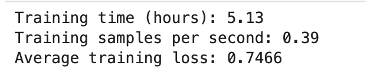

**Training and validation results per epoch:**

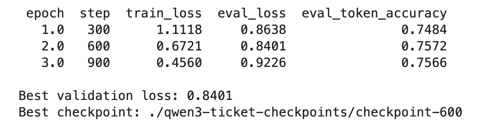

**Training and validation loss:** the training loss has a staircase shape, and the gap to the validation loss grows in epoch 3, which shows the overfitting.

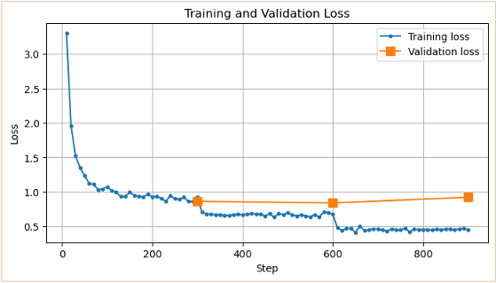

## Results (301 Test Tickets)
Both models were evaluated on the same test tickets with the same system prompt.

**Base model vs. fine-tuned model:**

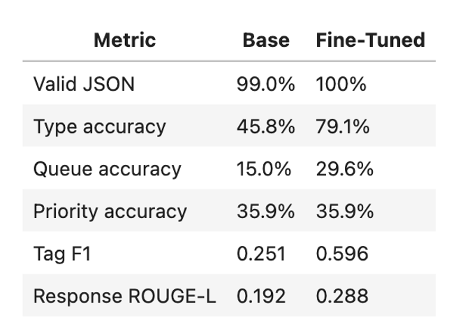

- Type accuracy increased by 33 points, and tag F1 more than doubled.
- Queue accuracy doubled, but it is only slightly above always predicting the most common queue (25.9%).
- Priority accuracy did not change.

**Results per language:** English and German tickets improved in the same way.

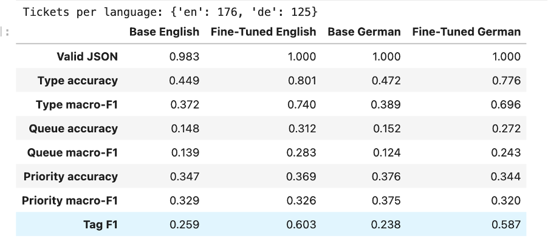

**Queue errors of the fine-tuned model:** Billing and Payments is routed best (F1 0.62), while General Inquiry (F1 0.00) and IT Support (F1 0.10) are the weakest, because queues with overlapping topics are hard to separate.

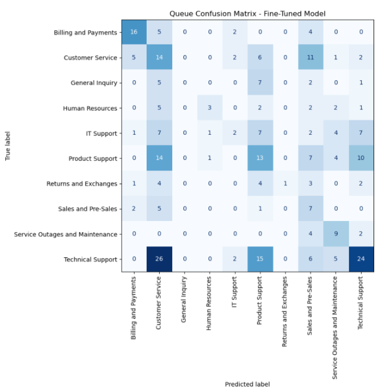

**Response similarity (ROUGE-L):** fine-tuning increased ROUGE-L from 0.192 to 0.288, with the largest gain for German tickets (0.099 to 0.259).

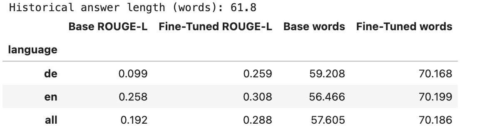

## Streamlit Application
- **Analyze Ticket:** paste a ticket or load an example from the test set. The app shows the predicted type, queue, priority, and tags, a validation check (valid JSON and allowed labels), and an editable draft response.
- **Human in the loop:** the agent replaces the flagged placeholders, edits the draft, and approves it. The ticket is saved to a local ticket log (demo, no email is sent).
- **Submitted Tickets and Analytics:** a ticket log where the status can be changed, plus tickets processed, average generation time, responses edited by the agent, and tickets per day.
- **Transparency:** I added About the model and the System prompt view to make the AI chatbot transparent. The app also shows the raw model output (JSON), and has Responsible AI and Help sections.

### Screenshots- AI-Powered Customer Support Ticket Assistant 
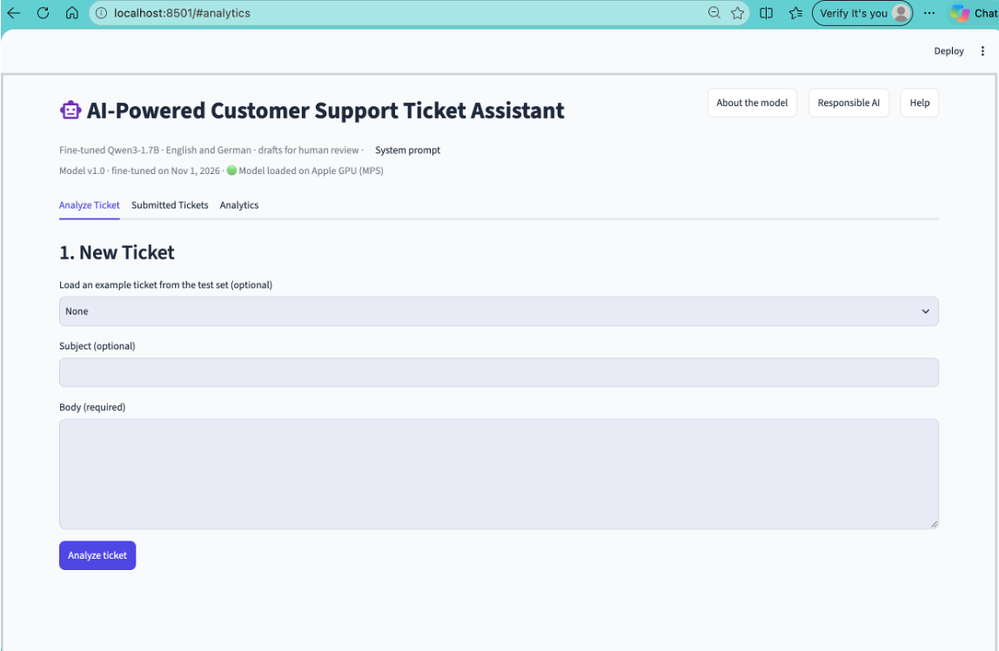

<table>
  <tr>
    <td width="50%" valign="top">
      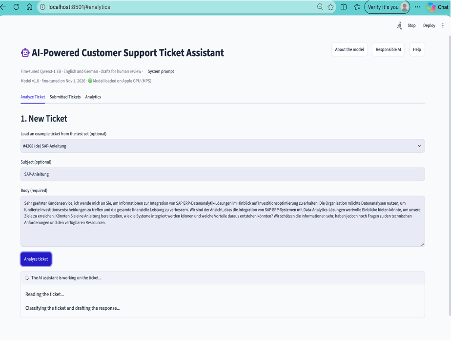<br>
      <b>New ticket:</b> load an example ticket from the test set or paste the subject and body, then click Analyze ticket.
    </td>
    <td width="50%" valign="top">
      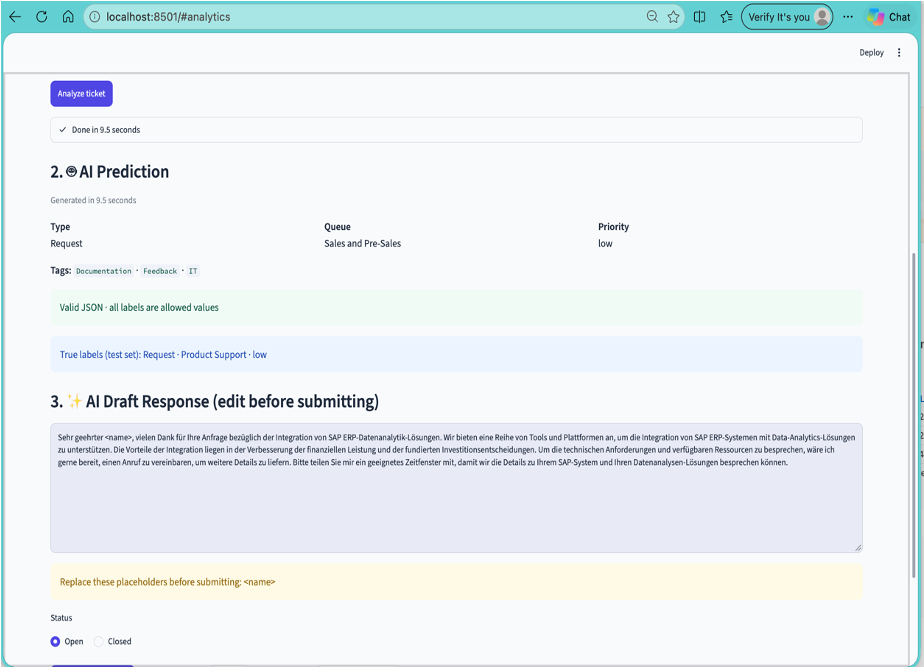<br>
      <b>AI prediction:</b> type, queue, priority, tags, the validation check, and the true labels for example tickets.
    </td>
  </tr>
  <tr>
    <td width="50%" valign="top">
      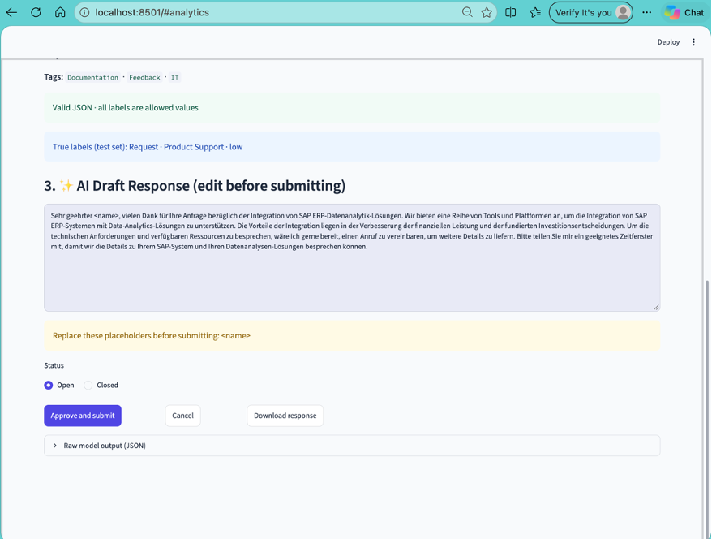<br>
      <b>AI draft response:</b> the agent edits the draft, replaces the flagged placeholders, and chooses the status.
    </td>
    <td width="50%" valign="top">
      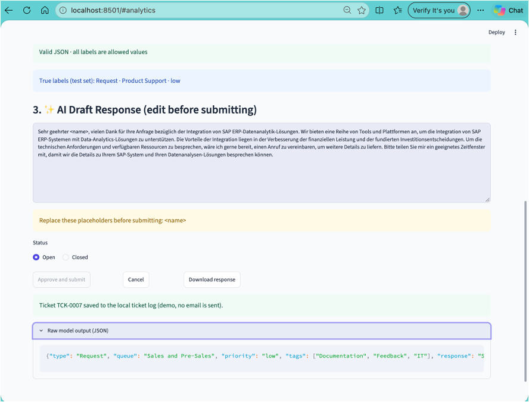<br>
      <b>Approve and submit:</b> the ticket is saved to the local ticket log for demo, no email is sent.
    </td>
  </tr>
  <tr>
    <td width="50%" valign="top">
      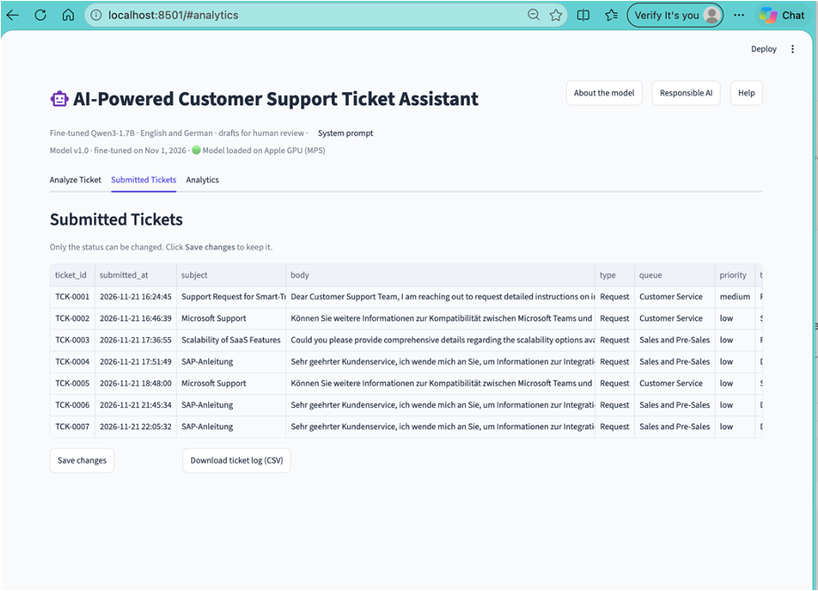<br>
      <b>Submitted Tickets:</b> only the status can be changed; the ticket log can be downloaded as CSV.
    </td>
    <td width="50%" valign="top">
      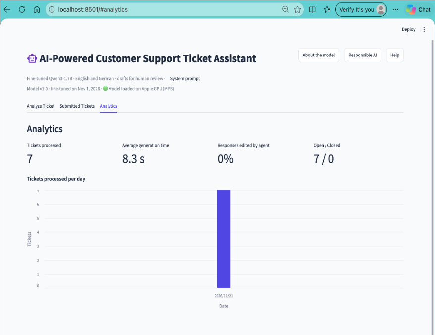<br>
      <b>Analytics:</b> tickets processed, average generation time, responses edited by agent, Open / Closed, tickets per day.
    </td>
  </tr>
  <tr>
    <td width="50%" valign="top">
      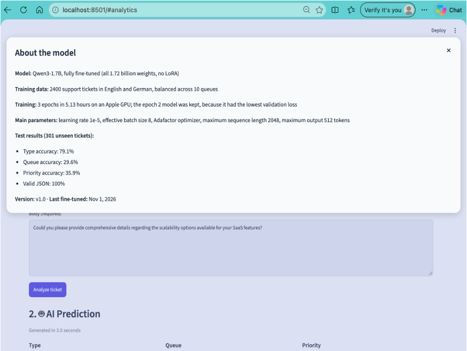<br>
      <b>About the model:</b> a dialog pop-up from the "About the model" button.
    </td>
    <td width="50%" valign="top">
      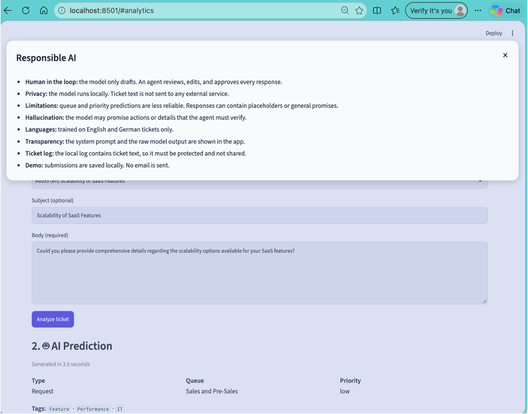<br>
      <b>Responsible AI:</b> a dialog pop-up from the "Responsible AI" button.
    </td>
  </tr>
  <tr>
    <td width="50%" valign="top">
      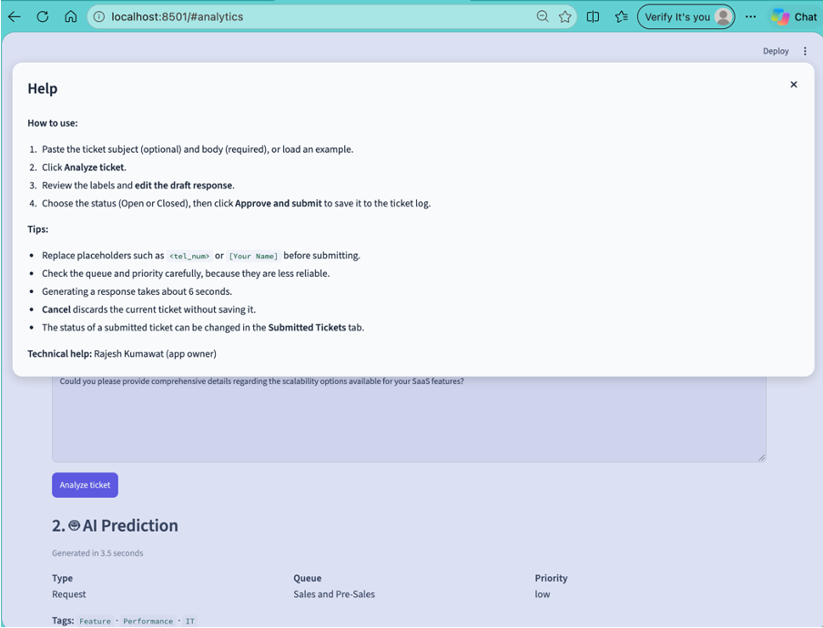<br>
      <b>Help:</b> a dialog pop-up from the "Help" button.
    </td>
    <td width="50%"></td>
  </tr>
</table>

## How to Run
The fine-tuned model (3.44 GB) is not included in this repository. Place it in the `qwen3-ticket-finetuned/` folder, then run:

```bash
conda activate project_environment
cd project_folder
streamlit run AI_Customer_Support_app.py
```

Open http://localhost:8501 in the browser.

```
project_folder/
├── AI_Customer_Support_app.py
├── AI_Customer_Support_Fine_Tuned_Model.py
├── .streamlit/config.toml
├── qwen3-ticket-finetuned/
└── project_data/   (test.csv, system_prompt.txt; ticket_log.csv is created later)
```

## Conclusion
Full fine-tuning of a small open-weight model on 2400 tickets clearly improved type classification, tags, valid JSON, and response similarity. Queue routing improved only moderately, and priority did not improve. The fine-tuned responses follow the style of the historical answers but contain placeholders such as `<tel_num>`, so the application keeps a human agent in the loop to review every response before sending.

## Limitations
- Only 2400 of 48419 clean tickets were used for training.
- The system prompt is about 90% of each training example, which made training and generation slower.
- Several queues overlap in meaning, and the priority may not be visible in the ticket text.
- The language labels of the dataset are not always correct.
- The model has no access to company knowledge, for example policies, products, or contact details.

## Future Enhancements
- Retrieval-augmented generation (RAG): retrieve the most similar training tickets with their labels and answers, and add them to the prompt.
- Create the support ticket automatically through the app when the agent approves the response.
- Train for 2 epochs with more training tickets, and test a shorter system prompt.
- Fine-tune a larger model of the same family (Qwen3-8B) on a cloud GPU.
- Detect the ticket language, and route German tickets to a separate model using a framework like LangChain.

## Tools
`Python` `PyTorch` `Hugging Face Transformers` `Datasets` `scikit-learn` `Streamlit` `Altair` `pandas`: full fine-tuning (no LoRA), prompt experiments, structured JSON output, ROUGE-L

## Files in this folder
- `AI_Customer_Support_app.py`: Streamlit application (user interface)
- `AI_Customer_Support_Fine_Tuned_Model.py`: model loading, generation, and JSON output checks
- `.streamlit/config.toml`: app theme
- `AI_Customer_Support_Ticket_Assistant.pptx`: project presentation with app screenshots
- The full notebook of fine-tuned model is available on request.
---
Part of [Data Science Portfolio](https://github.com/rajesh-k07/data-science-portfolio/tree/main)

**Main site:** [rajesh-k07.github.io](https://rajesh-k07.github.io)
