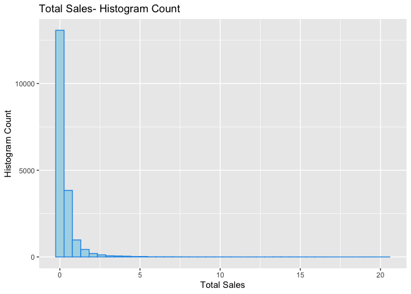
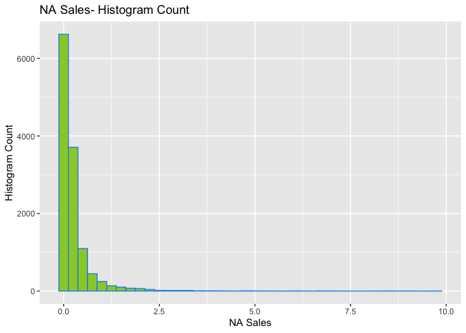
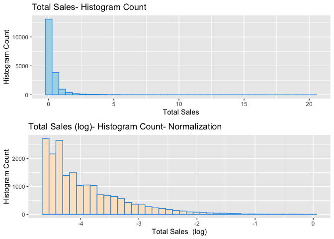
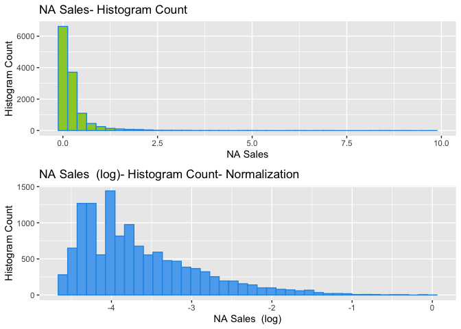
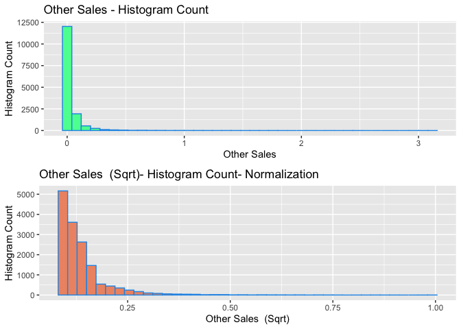

### load libraries

``` r
library(tidyverse)
library(e1071)
library(gridExtra)
```

### load vgchartz-2024.csv file

``` r
# read_csv only 
vgchartz_2024 <- readr::read_csv('vgchartz-2024.csv', col_names = TRUE, show_col_types= FALSE)

# Dataframe concise summary
glimpse(vgchartz_2024)
```

    ## Rows: 64,016
    ## Columns: 14
    ## $ img          <chr> "/games/boxart/full_6510540AmericaFrontccc.jpg", "/games/…
    ## $ title        <chr> "Grand Theft Auto V", "Grand Theft Auto V", "Grand Theft …
    ## $ console      <chr> "PS3", "PS4", "PS2", "X360", "PS4", "X360", "X360", "PS4"…
    ## $ genre        <chr> "Action", "Action", "Action", "Action", "Shooter", "Shoot…
    ## $ publisher    <chr> "Rockstar Games", "Rockstar Games", "Rockstar Games", "Ro…
    ## $ developer    <chr> "Rockstar North", "Rockstar North", "Rockstar North", "Ro…
    ## $ critic_score <dbl> 9.4, 9.7, 9.6, NA, 8.1, 8.7, 8.8, 9.8, 8.4, 8.0, 9.5, 8.1…
    ## $ total_sales  <dbl> 20.32, 19.39, 16.15, 15.86, 15.09, 14.82, 14.74, 13.94, 1…
    ## $ na_sales     <dbl> 6.37, 6.06, 8.41, 9.06, 6.18, 9.07, 9.76, 5.26, 8.27, 4.9…
    ## $ jp_sales     <dbl> 0.99, 0.60, 0.47, 0.06, 0.41, 0.13, 0.11, 0.21, 0.07, 0.6…
    ## $ pal_sales    <dbl> 9.85, 9.71, 5.49, 5.33, 6.05, 4.29, 3.73, 6.21, 4.32, 5.8…
    ## $ other_sales  <dbl> 3.12, 3.02, 1.78, 1.42, 2.44, 1.33, 1.14, 2.26, 1.20, 2.2…
    ## $ release_date <date> 2013-09-17, 2014-11-18, 2002-10-28, 2013-09-17, 2015-11-…
    ## $ last_update  <date> NA, 2018-01-03, NA, NA, 2018-01-14, NA, NA, 2018-11-02, …

``` r
# Let's check the skewness and mean for features that have numerical values 
skews <- apply(vgchartz_2024[, 7:12], 2, skewness, na.rm = TRUE)
mean <- apply(vgchartz_2024[, 7:12], 2, mean, na.rm = TRUE)

skews # skewness for numeric features
```

    ## critic_score  total_sales     na_sales     jp_sales    pal_sales  other_sales 
    ##   -0.9102278    8.7739421    6.8967354    4.4884035    9.5846671    9.7926082

**We can see high positive skewness in total_sales, na_sales, jp_sales,
pal_sales, other_sales, and negative skewness for critic_score. We can
draw histogram for total_sales and na_sales features, and visualize the
skewness.**

``` r
p_ts <- ggplot(data=vgchartz_2024, mapping = aes(x = total_sales, na.rm = TRUE)) +
  geom_histogram(bins = 40, fill = "lightblue", color = 4) +
  labs(x = "Total Sales", y = "Histogram Count", title = "Total Sales- Histogram Count") 

# Total Sales
p_ts
```

    ## Warning: Removed 45094 rows containing non-finite outside the scale range
    ## (`stat_bin()`).

<!-- -->

``` r
p_na <- ggplot(data=vgchartz_2024, mapping = aes(x = na_sales, na.rm = TRUE)) +
  geom_histogram(bins = 40, fill = "yellowgreen", color = 4) +
  labs(x = "NA Sales", y = "Histogram Count", title = "NA Sales- Histogram Count") 

# NA Sales
p_na
```

    ## Warning: Removed 51379 rows containing non-finite outside the scale range
    ## (`stat_bin()`).

<!-- -->

### Scaling

**We will scale the numeric features using Min-Max scale.**

*In scaling, we are changing the range of our data*

``` r
# min_max scale function, min range is 0.01 because we will use log method for normalization.
# log transformation is valid only positive values.
# It is used for power-law distributed data.

# min = 0.01 and max = 1
min_max_scale <- function(x, new_min = 0.01, new_max = 1) {
  scaled <- (x - min(x, na.rm = TRUE)) / (max(x, na.rm = TRUE) - min(x, na.rm = TRUE))
  scaled * (new_max - new_min) + new_min
}


# Scales datafrane using min_max_scale
vgchartz_2024_scaled <- as.data.frame(lapply(vgchartz_2024[, sapply(vgchartz_2024, is.numeric)], min_max_scale))

# Scaled dataframe concise summary
glimpse(vgchartz_2024_scaled)
```

    ## Rows: 64,016
    ## Columns: 6
    ## $ critic_score <dbl> 0.934, 0.967, 0.956, NA, 0.791, 0.857, 0.868, 0.978, 0.82…
    ## $ total_sales  <dbl> 1.0000000, 0.9546900, 0.7968356, 0.7827067, 0.7451919, 0.…
    ## $ na_sales     <dbl> 0.6561373, 0.6246926, 0.8630635, 0.9289959, 0.6368648, 0.…
    ## $ jp_sales     <dbl> 0.47014085, 0.28887324, 0.22845070, 0.03788732, 0.2005633…
    ## $ pal_sales    <dbl> 1.0000000, 0.9859289, 0.5617868, 0.5457056, 0.6180711, 0.…
    ## $ other_sales  <dbl> 1.0000000, 0.9682692, 0.5748077, 0.4605769, 0.7842308, 0.…

``` r
# skewness of scaled dataframe. skewness will remain same, since it is not normalized yet
skews_sc <- apply(vgchartz_2024_scaled[, 1:6], 2, skewness, na.rm = TRUE)

# Min and Max value of features after scaling
min_sc <- apply(vgchartz_2024_scaled[, 1:6], 2, min, na.rm = TRUE)
max_sc <- apply(vgchartz_2024_scaled[, 1:6], 2, max, na.rm = TRUE)
```

### Scaled values min and max for numerics features

``` r
# Minimum value of scaled features
min_sc
```

    ## critic_score  total_sales     na_sales     jp_sales    pal_sales  other_sales 
    ##         0.01         0.01         0.01         0.01         0.01         0.01

``` r
# Maximum value of scaled features
max_sc
```

    ## critic_score  total_sales     na_sales     jp_sales    pal_sales  other_sales 
    ##            1            1            1            1            1            1

### Fix the skewness using Log method.

``` r
vgchartz_2024_scaled$total_sale_lg <- log(vgchartz_2024_scaled$total_sales) 
vgchartz_2024_scaled$na_sale_lg <- log(vgchartz_2024_scaled$na_sales) 
vgchartz_2024_scaled$jp_sale_lg <- log(vgchartz_2024_scaled$jp_sales) 
vgchartz_2024_scaled$pal_sale_lg <- log(vgchartz_2024_scaled$pal_sales) 
```

### Fix the skewness using Square Root method.

``` r
# Fix the skewness using sqrt method.
vgchartz_2024_scaled$other_sale_sq <- sqrt(vgchartz_2024_scaled$other_sales) 

# Skewness for numerics features after normalization.
skews_sc_norm <- apply(vgchartz_2024_scaled[, 7:11], 2, skewness, na.rm = TRUE)
```

***In Normalization, we are changing the shape of the distribution of
our data.***

``` r
skews_sc  # skewness before normalization
```

    ## critic_score  total_sales     na_sales     jp_sales    pal_sales  other_sales 
    ##   -0.9102278    8.7739421    6.8967354    4.4884035    9.5846671    9.7926082

``` r
skews_sc_norm # skewness after normalization using log and sqrt methods
```

    ## total_sale_lg    na_sale_lg    jp_sale_lg   pal_sale_lg other_sale_sq 
    ##     1.5087957     1.1725865     0.7514161     1.7212468     4.2120145

``` r
p_ts_lg <- ggplot(data=vgchartz_2024_scaled, mapping = aes(x = total_sale_lg, na.rm = TRUE)) +
  geom_histogram(bins = 40, fill = "bisque1", color = 4) +
  labs(x = "Total Sales  (log)", y = "Histogram Count", title = "Total Sales (log)- Histogram Count- Normalization") 

p_na_lg <- ggplot(data=vgchartz_2024_scaled, mapping = aes(x = na_sale_lg, na.rm = TRUE)) +
  geom_histogram(bins = 40, fill = "steelblue2", color = 4) +
  labs(x = "NA Sales  (log)", y = "Histogram Count", title = "NA Sales  (log)- Histogram Count- Normalization") 

p_ots <- ggplot(data=vgchartz_2024, mapping = aes(x = other_sales, na.rm = TRUE)) +
  geom_histogram(bins = 40, fill = "seagreen1", color = 4) +
  labs(x = "Other Sales", y = "Histogram Count", title = "Other Sales - Histogram Count") 

p_ots_sq <- ggplot(data=vgchartz_2024_scaled, mapping = aes(x = other_sale_sq, na.rm = TRUE)) +
  geom_histogram(bins = 40, fill = "lightsalmon2", color = 4) +
  labs(x = "Other Sales  (Sqrt)", y = "Histogram Count", title = "Other Sales  (Sqrt)- Histogram Count- Normalization") 
```

### We can compare the features after the normalization using histogram

**Improved Skewness** *It is not perfect yet, but it is still better
than raw data.*

``` r
# Total Sales
P1 = grid.arrange(p_ts,p_ts_lg)
```

    ## Warning: Removed 45094 rows containing non-finite outside the scale range
    ## (`stat_bin()`).
    ## Removed 45094 rows containing non-finite outside the scale range
    ## (`stat_bin()`).

<!-- -->

``` r
# Na Sales
P2 = grid.arrange(p_na,p_na_lg)
```

    ## Warning: Removed 51379 rows containing non-finite outside the scale range
    ## (`stat_bin()`).

    ## Warning: Removed 51379 rows containing non-finite outside the scale range
    ## (`stat_bin()`).

<!-- -->

``` r
# Other Sales
P3 = grid.arrange(p_ots,p_ots_sq)
```

    ## Warning: Removed 48888 rows containing non-finite outside the scale range
    ## (`stat_bin()`).

    ## Warning: Removed 48888 rows containing non-finite outside the scale range
    ## (`stat_bin()`).

<!-- -->
